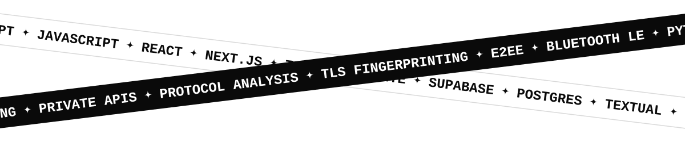

<!-- Everything in /assets is drawn by scripts/render.py; star counts refresh daily via .github/workflows/refresh.yml -->

 

**I take closed apps apart and rebuild their private APIs as clean Python SDKs.** 

 

 

<picture>
  <source media="(prefers-color-scheme: dark)" srcset="./assets/h-projects-dark.svg" />
  
</picture>

  
  
  
  

<picture>
  <source media="(prefers-color-scheme: dark)" srcset="./assets/tapes-dark.svg" />
  
</picture>

<picture>
  <source media="(prefers-color-scheme: dark)" srcset="./assets/footer-dark.svg" />
  
</picture>
